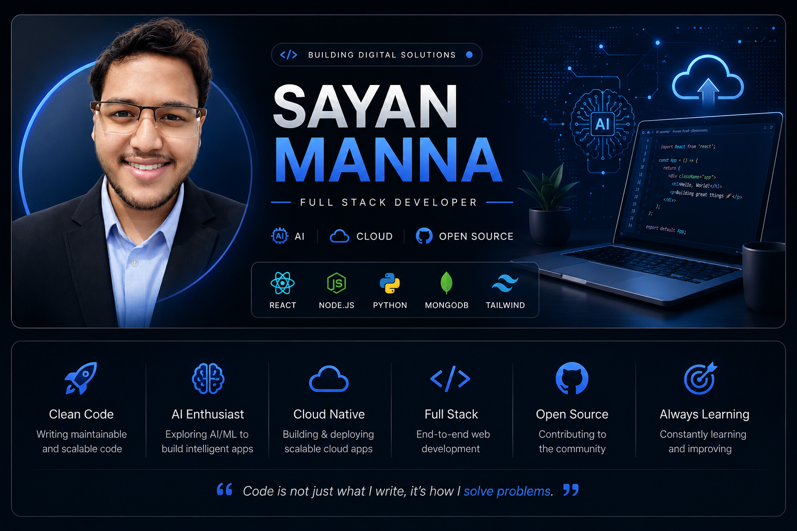

<!-- ==================== PROFILE HEADER ==================== -->

  

  

<h1 align="center">Sayan Manna</h1>

<h3 align="center">
  Full Stack Developer | Data Analytics | AI/ML
</h3>

  <strong>BCA Student</strong> 
  Bhawanipur Global Campus (BGC), formerly NSHM Knowledge Campus, Kolkata

  Developing modern web applications, exploring data-driven solutions,
  and building practical software projects.

  
  
  

  

---

## About Me

I am a **BCA student at Bhawanipur Global Campus (BGC), formerly NSHM Knowledge Campus, Kolkata**, interested in software development, data analytics, and artificial intelligence.

My focus is on building practical applications, analyzing data, and exploring machine learning to solve real-world problems.

### Areas of Focus

- **Full Stack Development:** Responsive web applications and backend APIs
- **Data Analytics:** Data exploration, analysis, and visualization
- **AI & Machine Learning:** Learning model development and evaluation
- **Software Engineering:** Clean code, problem-solving, and application design

### Current Priorities

- Developing practical, portfolio-ready projects
- Strengthening programming and analytical skills
- Exploring machine learning workflows
- Improving backend development and software architecture
- Gaining hands-on experience through real-world projects

### Career Objective

To grow as a software developer by building useful applications, applying analytical thinking, and continuously improving my technical skills.

  
  

 

---

<h2 align="center">Technical Skills & Technologies</h2>

  Technologies I use and explore across software development, data analytics, and AI/ML.

### Frontend Development

  

### Backend Development

  

### Programming Languages

  

### Data Analytics & Machine Learning

  
  
  
  
  

### Databases

  

### Developer Tools & Platforms

  

  <i>Continuously expanding my toolkit through hands-on development and project work.</i>

---

<h2 align="center">Featured Projects</h2>

  Selected projects across software development, data analytics, and Python.

<table>
<tr>
<td width="50%" valign="top">

<h3>1. Developer Portfolio</h3>

A responsive personal website showcasing my development projects and professional profile.

<strong>Tech Stack:</strong> React · Tailwind CSS · JavaScript

<a href="https://portfolio-website-v1-alpha.vercel.app/">Live Demo</a> ·
<a href="https://github.com/iamsayanmanna/portfolio-website">Source Code</a>

</td>
<td width="50%" valign="top">

<h3>2. Air Quality Research</h3>

A research project exploring air-quality data, visualizations, and machine-learning model reliability during extreme pollution episodes.

<strong>Focus:</strong> Python · Data Analytics · Machine Learning

<a href="https://github.com/iamsayanmanna/Air-Quality-Research">Source Code</a>

</td>
</tr>
<tr>
<td width="50%" valign="top">

<h3>3. MAUSAM — Weather Application</h3>

A personalized weather application focused on location-aware forecasts and relevant weather alerts.

<strong>Focus:</strong> Weather Data · Personalization · Application Development

<a href="https://github.com/iamsayanmanna/Mausam-App">Mobile App</a> ·
<a href="https://github.com/iamsayanmanna/mausam-backend">Backend</a>

</td>
<td width="50%" valign="top">

<h3>4. Stock Portfolio Tracker</h3>

A Python project designed to track stock investments and organize portfolio-related calculations.

<strong>Tech Stack:</strong> Python

<a href="https://github.com/iamsayanmanna/CodeAlpha_Stock_Portfolio_Tracker">Source Code</a>

</td>
</tr>
</table>

  

---

<h2 align="center">GitHub Analytics</h2>

  An overview of my GitHub activity, contributions, and language usage.

<table>
  <tr>
    <td width="50%" align="center" valign="middle">
      
    </td>
    <td width="50%" align="center" valign="middle">
      
    </td>
  </tr>
</table>

---

<h2 align="center">GitHub Trophies</h2>

  A snapshot of my GitHub milestones and achievements.

  

  

---

<h2 align="center">Contribution Activity</h2>

  A visual overview of my GitHub contribution activity.

  

---

---

<h2 align="center">Contribution Snake</h2>

  Watch my GitHub contributions come to life.

  

---

---

<h2 align="center">Profile Highlights</h2>

<table align="center">
  <tr>
    <td align="center" width="33%">
      
       
      Projects & Repositories
    </td>
    <td align="center" width="33%">
      
       
      Achievements & Milestones
    </td>
    <td align="center" width="33%">
      
       
      Professional Network
    </td>
  </tr>
</table>

---

---

  

<h3 align="center">Let's Build Something Meaningful</h3>

  Open to meaningful collaborations, practical projects, and opportunities to learn and grow.

  <a href="https://portfolio-website-v1-alpha.vercel.app/">Portfolio</a>
  &nbsp;·&nbsp;
  <a href="https://www.linkedin.com/in/iamsayanmanna/">LinkedIn</a>
  &nbsp;·&nbsp;
  <a href="mailto:sayanmanna.in@gmail.com">Email</a>
  &nbsp;·&nbsp;
  <a href="https://github.com/iamsayanmanna">GitHub</a>

  Designed with care by Sayan Manna · Continuously learning, building, and improving.

---

<h3 align="center">
✨ Thanks for visiting my profile! Let's build something amazing together. 🚀
</h3>

